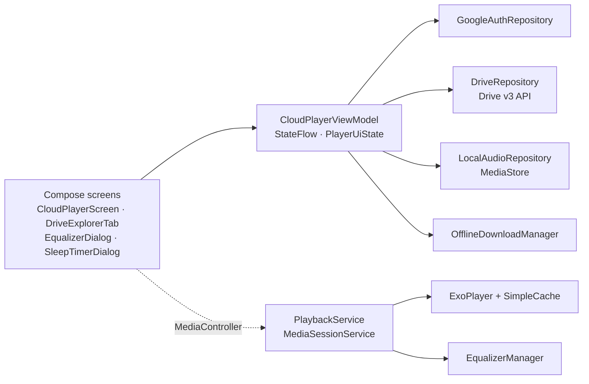

<p align="center">
  
</p>

   

CloudPlayer turns your Google Drive into a music library. Sign in once, browse your Drive folders like a file manager, and play any audio file — streamed with caching, or downloaded for offline listening. Everything is built in Jetpack Compose on top of Media3, with Hilt wiring the layers together.

It is the largest project in this portfolio (~2,400 lines) and the one closest to a real production app.

## Features

- **Google Sign-In with Drive access** — read-only `DRIVE_READONLY` scope, so the app can never modify your files
- **Drive explorer** — open folders, navigate back through a breadcrumb trail, folders listed before files
- **Streaming with a 100 MB LRU cache** — tracks you replay don't hit the network again
- **Offline downloads** with progress, stored in app-private storage
- **Local library** — device music discovered through `MediaStore`
- **Background playback** in a `MediaSessionService`, with lock-screen and notification controls
- **10-band style equalizer + bass boost** built on `android.media.audiofx`
- **Sleep timer**, favorites, search, shuffle and repeat (off / one / all)
- **Navigation drawer** with seven sections: Home, Drive folders, Offline, Favorites, Equalizer, Sleep timer, Settings

## How it works

### Streaming private Drive files
Drive files need an OAuth token on every request, which ExoPlayer knows nothing about. `PlaybackService` solves it by wrapping the HTTP data source in a `ResolvingDataSource` that injects the header just before each request:

```kotlin
dataSpec.withAdditionalHeaders(mapOf("Authorization" to "Bearer $token"))
```

That data source is then wrapped again in a `CacheDataSource` backed by a `SimpleCache` with a `LeastRecentlyUsedCacheEvictor(100 MB)`, so playback, seeking and replays are served from disk whenever possible.

### Listing the Drive
`DriveRepository` uses the Drive v3 API with server-side filtering, so only relevant files ever come over the network:

```kotlin
"'$folderId' in parents and (mimeType = 'application/vnd.google-apps.folder' or mimeType contains 'audio/') and trashed = false"
```

### State
A single `CloudPlayerViewModel` exposes one immutable `PlayerUiState` through a `StateFlow`. The Compose screens only read that state and call intent-style functions (`openFolder`, `toggleShuffle`, `setSleepTimer`, …), which keeps the UI free of business logic.

## Architecture



## Project structure

```
com.example.cloudplayer
├── CloudPlayerApp.kt
├── MainActivity.kt
├── data/
│   ├── model/DriveAudioItem.kt
│   ├── model/DriveFolderItem.kt
│   ├── repository/DriveRepository.kt
│   ├── repository/EqualizerManager.kt
│   ├── repository/GoogleAuthRepository.kt
│   ├── repository/LocalAudioRepository.kt
│   ├── repository/OfflineDownloadManager.kt
│   ├── repository/TokenManager.kt
├── di/
│   ├── AppModule.kt
├── service/
│   ├── PlaybackService.kt
├── ui/
│   ├── screen/AppNavigationDrawer.kt
│   ├── screen/CloudPlayerScreen.kt
│   ├── screen/DriveExplorerTab.kt
│   ├── screen/EqualizerDialog.kt
│   ├── screen/SleepTimerDialog.kt
│   ├── theme/Color.kt
│   ├── theme/Theme.kt
│   ├── theme/Type.kt
│   ├── viewmodel/CloudPlayerViewModel.kt
```

<sub>21 source files · 2,388 lines of code</sub>

## Tech stack

| | |
|---|---|
| **Language** | Kotlin |
| **UI** | Jetpack Compose |
| **Min / Target SDK** | 24 / 34 |
| **Hilt** | Dependency injection |
| **Media3 ExoPlayer** | Audio playback |
| **Coil** | Image loading |
| **Navigation component** | Screen navigation |
| **Google Sign-In** | Authentication |
| **Google Drive API** | Cloud files |
| **Kotlin Coroutines** | Async work |
| **ViewModel** | UI state |
| **Guava** | Futures |

## Getting started

```bash
git clone https://github.com/rajabbov/CloudPlayer.git
```

1. Open the folder in **Android Studio** (Ladybug or newer).
2. Let Gradle sync.
3. Complete the configuration below, then run the `app` configuration.

### Configuration

Drive access needs an OAuth client registered for **your** signing key:

1. In the [Google Cloud Console](https://console.cloud.google.com/), create a project and enable the **Google Drive API**.
2. Configure the OAuth consent screen and add your Google account as a test user.
3. Create an **Android** OAuth client with package `com.example.cloudplayer` and the SHA-1 of your debug key (`./gradlew signingReport`).

Until you sign in, the app shows sample tracks and folders so the UI can be explored right away.

## Known limitations

- Sign-in uses the legacy `GoogleSignIn` API; migrating to Credential Manager is the next step.
- Downloads are saved with an `.mp3` extension regardless of the original format.

---

Made by **Ibrohimjon Rajabboyev** · [@rajabbov](https://github.com/rajabbov)
